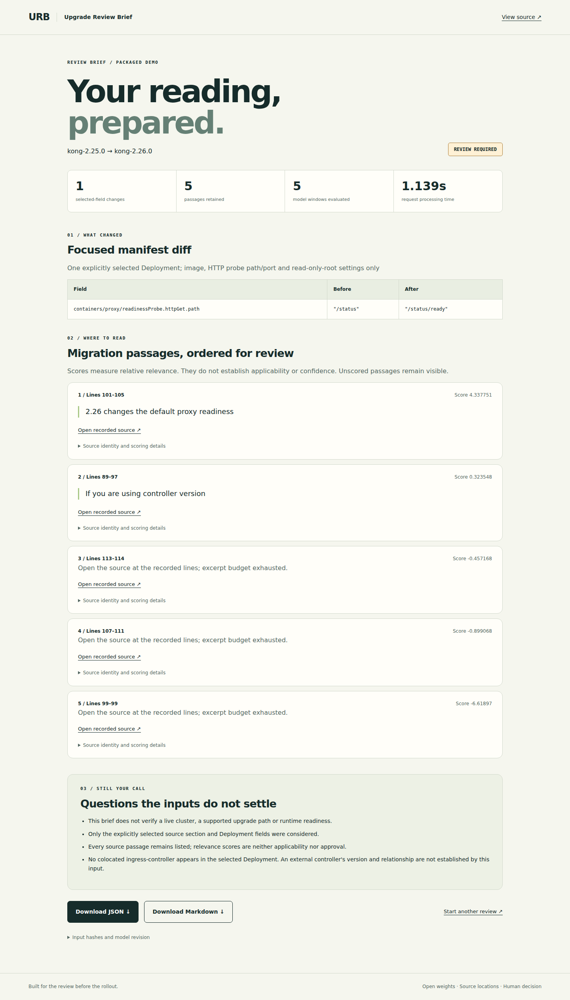

# Upgrade Review Brief

Helm upgrade reviewers must connect rendered Deployment changes to migration instructions.



| Measurement | Result | Evidence |
| --- | --- | --- |
| Final release verification | Pending Phase 8 | [Submission facts](SUBMISSION_FACTS.md) |
| Ranking backtest | NOT RUN under this directive | [Evaluation protocol](evaluation/PROTOCOL.md) |
| Determinism and Render measurements | Pending execution | [Submission facts](SUBMISSION_FACTS.md) |

## Quickstart

Run from the repository root with Python installed. This comparison command uses no model; model setup is documented separately.

```bash
python -m venv .venv
. .venv/bin/activate
python -m pip install -r requirements-web.txt
python prepare_brief_source.py
python upgrade_brief.py brief-cases/kong-readiness.json --root . --lexical-baseline
```

[](https://dashboard.render.com/blueprint/new?repo=https://github.com/EdwinJdevops/upgrade-review-brief)

Deploy button verification is pending. The existing hosted service was created separately from the Blueprint.

## Scope and limits

The brief compares one selected Deployment's container images, HTTP probe paths/ports and read-only-root setting, then presents guide passages for human review. Other manifest edits are inventoried but are not semantically validated. Uploaded source URLs are not fetched or authenticated during a review. The public demo receives uploads on its server; use sanitised inputs. No report approves an upgrade or applies changes. User effort saved and commercial demand have not been measured.

## Documentation

- [Live application](https://upgrade-review-brief.onrender.com) and [recorded demonstration](docs/demo/browser-demo.mp4)
- [Submission facts](SUBMISSION_FACTS.md) and [official requirements checklist](docs/SUBMISSION_CHECKLIST.md)
- [Deployment and model setup](RENDER_DEPLOYMENT.md)
- [Evidence history](docs/EVIDENCE.md)
- [Known weaknesses](docs/KNOWN_WEAKNESSES.md)
- [Product decisions](docs/PRODUCT_EVOLUTION.md) and [evaluation protocol](evaluation/PROTOCOL.md)
- [Third-party notices](THIRD_PARTY_NOTICES.md) and [Apache-2.0 licence](LICENSE)

Apache-2.0 is the owner's instructed licence decision. Third-party licences remain separate. The DEV draft is unpublished.
